# RAW 2 · ABRASION

Synthé VST3 pour Windows, suite de RAW. C++20, **sans JUCE ni framework** : la seule
dépendance externe est l'ensemble des en-têtes d'interface VST3 de Steinberg (licence MIT),
copiés dans `third_party/vst3/pluginterfaces`. Rien n'est téléchargé pendant la compilation.

Le projet reproduit la maquette « RAW 2 — maquette » (1280 × 960, version 2 avec la page EFX) et son
dossier de passation : les pages (dont ENV / LFO, et JEU ajoutée en v6), les 6 thèmes, les
72 presets (avec leurs effets, enveloppes et LFO), les packs de presets, les superpositions et
les comportements, avec un vrai moteur audio derrière.

**Nouveautés v6 à v8, pensées pour les beatmakers :**

- **v6, jeu** : POLY / MONO / LEGATO, glide, unison jusqu'à 8 voix, 16 voix de polyphonie, mode
  808 (punch de hauteur et sous-oscillateur), vélocité et molette comme sources de modulation,
  4 macros.
- **v7, couleur** : les effets VINTAGE (bande, vinyle, lo-fi) et PUMP (sidechain calé sur le
  tempo), un filtre 12 ou 24 dB avec drive, un BLEND A↔B.
- **v8, jeu et flux de travail** : un arpégiateur calé sur l'hôte, des accords en un doigt avec
  strum, des favoris et un bouton HASARD dans le navigateur, et l'export du son joué en WAV, à
  glisser directement dans la DAW.
- **Instruments réels** (ROMpler) : chaque oscillateur peut jouer un instrument multi-échantillonné
  au format SFZ. Une banque de 23 instruments sous licence libre (Wurlitzer, CP80, Pianet, string
  machines, cuivres, basses et sifflet G-funk, sax, vibraphone…) est livrée à part, avec le pack
  de 24 presets « RAW 2 · INSTRUMENTS » (French touch, boom bap, G-funk, soul, lo-fi, trap). Voir
  [`docs/INSTRUMENTS.md`](docs/INSTRUMENTS.md).

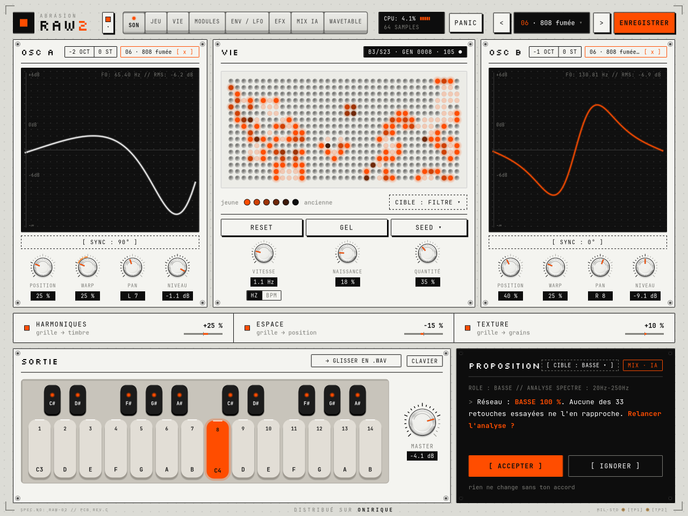

## Compiler sous Windows (Visual Studio 2026, PowerShell)

Prérequis : Visual Studio 2026 (Community suffit) avec la charge de travail
« Développement Desktop en C++ » (elle installe CMake et le SDK Windows 10/11).

Dans « Developer PowerShell for VS », depuis le dossier décompressé :

```powershell
cd $HOME\raw2
cmake -S . -B build -G "Visual Studio 18 2026" -A x64
cmake --build build --config Release
```

Résultat :

- `build\VST3\RAW2.vst3\` : le plugin (un dossier, à copier en entier) ;
- `build\bin\RAW2Preview.exe` : l'interface et le son **sans DAW** (sortie WASAPI, notes au
  clavier à l'écran). Pratique pour essayer les presets.
- `build\bin\raw2_train.exe` : l'outil qui entraîne l'IA (facultatif, les poids sont déjà
  fournis).

Installation, depuis un PowerShell lancé **en administrateur** :

```powershell
cmake --install build --config Release --prefix "C:/Program Files/Common Files"
```

La commande copie `RAW2.vst3` dans `C:\Program Files\Common Files\VST3\`. Tu peux aussi
copier le dossier à la main, ou configurer avec `-DRAW2_DEPLOY=ON` pour que chaque compilation
le copie automatiquement (il faut alors lancer Visual Studio / PowerShell en administrateur).

Dans **FL Studio** : *Options → Manage plugins → Find installed plugins*, puis cherche
« RAW 2 » (fabricant ABRASION, catégorie Instrument / Synth).

## Version macOS (VST3 et Audio Unit)

RAW 2 tourne aussi sur Mac (Apple Silicon et Intel, macOS 10.15 et plus), en **VST3** et en
**Audio Unit** (instrument `aumu Raw2 Abrs`). Ableton Live 11 et 12 chargent l'un ou l'autre ;
Live 10, Logic Pro et GarageBand utilisent l'AU. Le code propre au Mac :

- `src/ui/CGCanvas.cpp` : le dessin avec CoreGraphics et CoreText (polices embarquées) ;
- `src/platform/MacView.mm` : la vue Cocoa (souris, clavier, glisser-déposer entrant et
  sortant, zoom) ;
- `src/au/Raw2AU.mm` : l'adaptateur Audio Unit v2, écrit directement sur l'API AudioComponent
  (sans JUCE) : paramètres, état, presets d'usine, tempo de l'hôte, vue Cocoa ;
- `src/platform/MacFiles.mm` : corbeille du Finder ; les réglages vont dans
  `~/Library/Application Support/ABRASION/RAW2.json`, les packs dans `~/Documents/Raw 2`.

Le workflow GitHub Actions `.github/workflows/raw2-macos.yml` compile le binaire universel
sur un Mac, lance les tests (dont l'hôte VST3 qui ouvre l'éditeur dans une fenêtre), valide
l'AU avec `auval`, fait des captures CoreGraphics et fabrique `RAW2-macOS-<version>.dmg`
(installeur `.pkg` + copie manuelle + `LISEZ-MOI.txt`). Sur un Mac, à la main :

```sh
cmake -S raw2 -B build -DCMAKE_BUILD_TYPE=Release "-DCMAKE_OSX_ARCHITECTURES=arm64;x86_64"
cmake --build build --parallel
# build/VST3/RAW2.vst3 -> ~/Library/Audio/Plug-Ins/VST3
# build/AU/RAW2.component -> ~/Library/Audio/Plug-Ins/Components
```

Tests (facultatif) : `ctest --test-dir build -C Release`.

Si CMake répond « could not find any instance of Visual Studio », vérifie le nom du générateur
(`"Visual Studio 17 2022"` pour VS 2022) et supprime le dossier `build` avant de relancer.

### Options CMake

| Option | Défaut | Effet |
|---|---|---|
| `RAW2_BUILD_VST3` | ON | le plugin |
| `RAW2_BUILD_PREVIEW` | ON | `RAW2Preview.exe` |
| `RAW2_BUILD_TESTS` | ON | tests du moteur, de l'IA et mini-hôte VST3 |
| `RAW2_BUILD_TRAINER` | ON | `raw2_train` (ré-entraîne l'IA), `raw2_fx_trim` (calibre le volume des presets avec effets) et `raw2_inst_pack` (génère le pack « RAW 2 · INSTRUMENTS ») |
| `RAW2_DEPLOY` | OFF | copie le plugin dans `%CommonProgramFiles%\VST3` après compilation |

## Ce qui est dans le plugin

### Interface (fidèle à la maquette)

- Plaque 1280 × 960, coins techniques, mention `DISTRIBUÉ SUR ONIRIQUE`, en-tête complet
  (logo, languette des thèmes, onglets, CPU / SAMPLES, PANIC, presets, ENREGISTRER).
- **Onglets en touches physiques** (v8.1) : un bloc de touches en aluminium jointives, séparées par
  de fines rainures, face plate légèrement dégradée et lèvre sombre qui montre l'épaisseur ; la page
  ouverte a sa touche enfoncée et un point orange au-dessus de son nom.
- Pages **SON, JEU, VIE, MODULES, ENV / LFO, EFX, MIX IA, WAVETABLE** avec toutes les cartes et tous les contrôles,
  dans le dessin de la maquette v2 : boutons moletés, afficheurs LCD, vis, écrans à lignes de
  balayage et tracés lumineux, grille de la vie en lentilles, sérigraphie du circuit en pied de page.
- **SON** : chaque oscillateur a POSITION, **WARP** (déformation de phase), **PAN** et NIVEAU, et un
  mode de départ de phase (SYNC 0°, 90°, 180°, LOOP, FREE) ; l'écran affiche la gamme et la
  télémétrie (note, fréquence, RMS). Le clavier (maquette mise à jour) occupe le rail du bas avec
  le potard MASTER ; pitch bend et modulation restent pilotés par les molettes du clavier maître.
- **JEU** (v6 à v8, mise en page refaite en v8.1 sur une grille de trois colonnes : dans chaque carte
  du haut, bandeau de choix, écran puis rangée de potards ; écrans de l'unison, du punch, de la
  réponse du filtre, de l'arpège et de l'accord ; bouton **→ BASSE 808** qui règle LEGATO + glide,
  punch et sub en un clic) : carte VOIX (POLY / MONO / LEGATO, glide TOUJOURS ou seulement entre notes
  LIÉES, unison 1 à 8 voix avec désaccord et largeur), carte 808 · SUB (punch de hauteur à
  l'attaque et sa durée, sous-oscillateur sinus, à l'octave ou une octave plus bas), carte FILTRE · VÉLOCITÉ
  (pente 12 / 24 dB, drive, vélocité → niveau et → filtre, BLEND A↔B), carte MACROS (4 macros, et
  les poignées VÉLOCITÉ et MOLETTE, à lâcher sur n'importe quel potard comme un LFO), cartes
  ARPÈGE (montant, descendant, aller-retour, au hasard, dans l'ordre joué ; 1/4 à 1/32 en
  triolets ; jusqu'à 4 octaves ; gate, swing, LATCH ; calé sur la lecture de l'hôte) et ACCORDS
  (10 accords en un doigt, avec strum).
- **EFX** : le rack de 12 effets (voir « Moteur audio »). Glisser une ligne par sa poignée ou
  utiliser ▲ ▼ pour changer l'ordre, interrupteur et MIX par ligne, BYPASS global ; à droite
  l'effet choisi avec sa courbe animée, ses 4 boutons, MODE et OVERSAMPLE pour la distorsion, la
  **modulation rapide** (VIE, LFO 1, LFO 2, ENV, CLAVIER, ALÉA → premier réglage) ; en bas DRY / WET
  et l'oscilloscope sec (pointillé) / traité, plus le spectre.
- **ENV / LFO** : une enveloppe par oscillateur (OSC A, OSC B) avec ses nœuds ADSR à déplacer à
  la souris, la courbe (LIN, EXP, LOG, EXTR), RETRIG / FREE (en FREE, une note jouée legato reprend
  l'enveloppe de la note tenue), LIER A↔B et COPIER A→B ; deux LFO (SINE, TRI, SAW, SQR, S&H) avec
  VITESSE (0,05 à 20 Hz, affichage Hz ou BPM), SYNC au tempo de l'hôte (1/1 à 1/16), PHASE et
  FADE IN (déplaçables sur le graphe), LISSAGE. Les points orange suivent le son en direct.
  **ÉDITION / DRAW** : la forme du LFO se dessine (double-clic : ajouter / retirer un nœud, glisser
  un nœud avec aimantation 1/16, 1/8 ou libre, glisser un segment : sa courbure, Maj + glisser :
  son adoucissement).
- **Glisser-déposer de modulation** : la poignée **[ ✛ MOD ]** de chaque LFO se lâche sur
  n'importe quel potard continu (toutes pages, les onglets s'ouvrent au survol pendant le
  glisser). Le potard reçoit un anneau orange ; glisser l'anneau verticalement règle le dosage
  (−100 à +100 % de la course du potard). Jusqu'à 40 routes libres, enregistrées avec le preset.
- **MODULES** : SIDE A, la matrice 6 × 8 et la liste des PATCHS (liaisons et routes libres) ;
  SIDE B, le **rack modulaire** : jusqu'à 6 LFO supplémentaires (R1 à R6) avec forme, vitesse,
  sync, phase, fade, lissage et dessin, à ajouter ou retirer.
- **Banque de presets** (maquette mise à jour) : **FACTORY** (INIT, preset vierge, puis les 72
  presets d'usine, filtres par catégorie et menu **GENRE**) et **USER** (les packs du dossier
  `Documents\Raw 2`, voir « Presets et fichiers »), avec [ INSTALLER UN PACK… ], [ PACKS DÉMO ] et
  [ + SAUVER LE SON ACTUEL ]. En v8, l'étoile de chaque ligne marque un **favori** (onglet
  FAVORIS, gardé d'une session à l'autre) et **HASARD** charge un preset au hasard dans la liste
  filtrée.
- **→ GLISSER EN .WAV** (carte SORTIE) : le son joué, avec ses effets, accords et arpège, est
  rendu dans un WAV 24 bits stéréo (`Documents\Raw 2\Exports`). Un clic exporte le fichier ; un
  glisser l'exporte et le dépose dans la DAW (piste FL Studio, Playlist, Edison…).
- **VIE** : le curseur **LISSAGE MODULATION** (0 à 500 ms) adoucit les sources de modulation.
- **MIX IA** (maquette mise à jour) : sonie M / S / I (BS.1770-4), LRA, PLR, True Peak avec maintien
  (RAZ PEAK), vectorscope, corrélation par bande (graves, médiums, aigus), largeur et balance.
  Le spectre montre la **courbe cible** du rôle et du profil (CIBLE) et marque les **excès** de
  résonance (EXCÈS). L'assistant propose des **actions correctives** selon le RÔLE (AUTO, BASSE,
  LEAD, PAD, ARP / SEQ, TEXTURE) et le PROFIL (NEUTRE, AGRESSIF, CHAUD, AÉRIEN, PROPRE) : après une
  écoute, chaque action est dosée sur l'écart mesuré au gabarit (une action que la mesure ne
  confirme pas est désactivée) et annotée par le réseau MixNet. Chaque action s'active, se dose
  (− / +) et ne s'applique que sur [ APPLIQUER ] ; l'historique garde les trois dernières, avec
  [ RESTAURER ].
- **WAVETABLE** : un WAV glissé sur un oscillateur peut aussi être **joué tel quel** (LECTURE AU
  CLAVIER : SAMPLE), transposé depuis sa note de base avec un étirement WSOLA qui garde sa durée
  (versions calculées en arrière-plan, de −12 à +24 demi-tons, 6 s au plus).
  **INSTRUMENT ▾** ouvre le navigateur des instruments multi-échantillonnés de
  `Documents\Raw 2\Instruments`, classés par catégorie (BASS, KEYS, PAD, BRASS…). L'instrument
  choisi est joué sur tout le clavier, avec ses couches de vélocité et ses boucles ; son nom
  s'affiche sur la page SON (« INST · … ») et il est enregistré avec le preset.
- Fenêtre de choix des presets (recherche sans accents, filtres, un clic charge et garde la
  fenêtre ouverte, Échap ferme), menus SEED et CIBLE, terminal PROPOSITION (machine à écrire
  20 ms/caractère), appui long de 600 ms sur le logo pour le mode X-Y avec son effet plein écran.
- 6 thèmes (`themes.json`) changés à la volée, panneau qui se déroule en 5 paliers. Le clavier suit
  la palette des thèmes clairs (ULTRAVIOLET, ONIRIQUE : rail, touches et dièses du thème) ; ALU
  garde son clavier grège et crème.
- Polices **JetBrains Mono** et **Silkscreen embarquées dans la DLL** (licence OFL, voir
  `resources/fonts`). Rendu Direct2D / DirectWrite, 60 images/s, sans animation douce.
- Glisser-déposer de WAV (OLE, avec surbrillance au survol), jamais d'explorateur au clic.
- **Zoom homothétique 75 / 100 / 125 / 150 %** : ajouté sous les pastilles du panneau des
  thèmes (la maquette ne disait pas où le mettre). Le dernier thème et le dernier zoom choisis
  deviennent ceux des nouvelles instances (`%APPDATA%\ABRASION\RAW2.json`).

| JEU (v6 à v8, preset « 808 fumée ») | INSTRUMENTS (v8) |
|---|---|
| 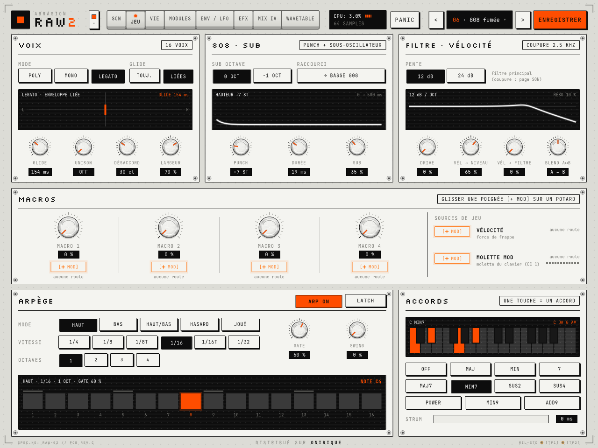 | 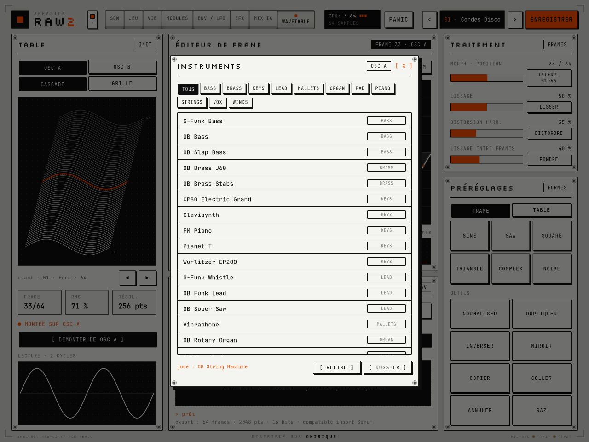 |

| ENV / LFO | Packs (onglet USER) |
|---|---|
| 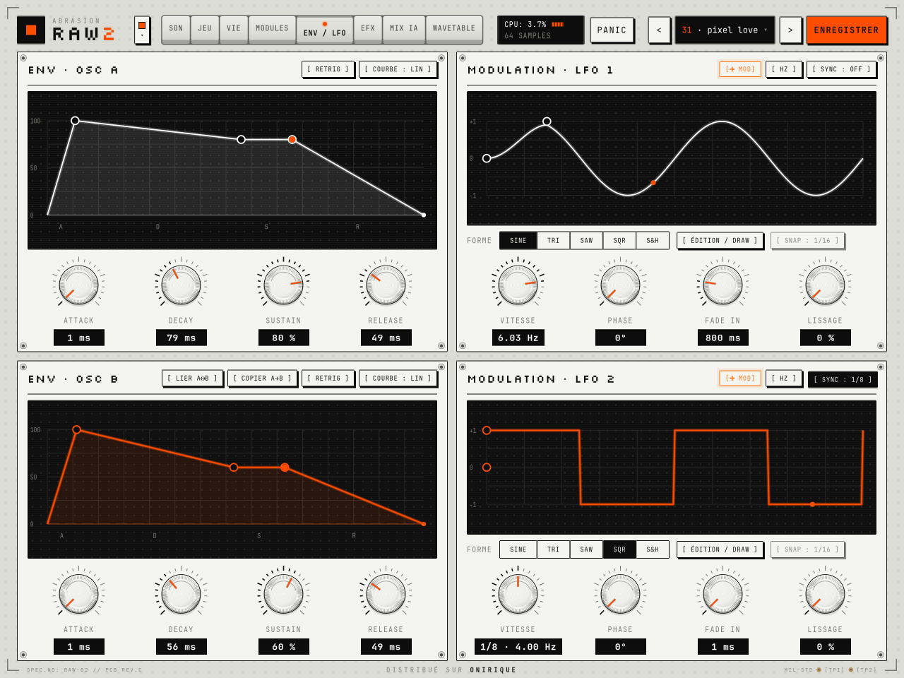 | 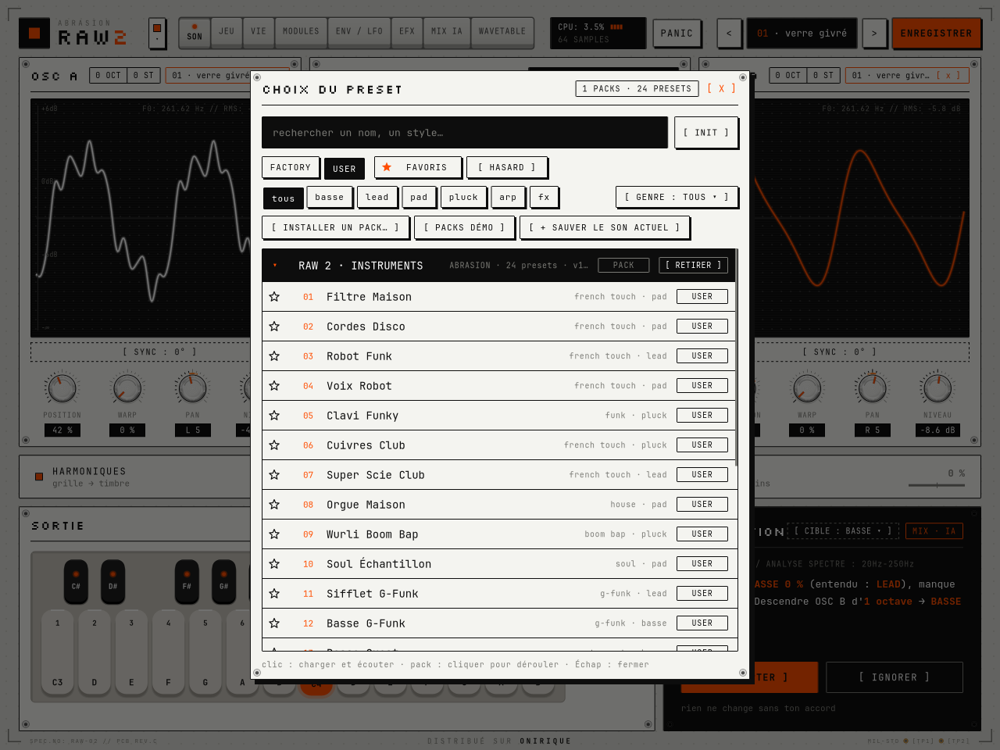 |
| **EFX** | **EFX, thème CRT** |
| 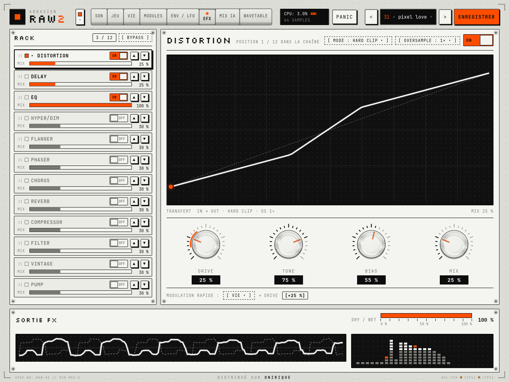 | 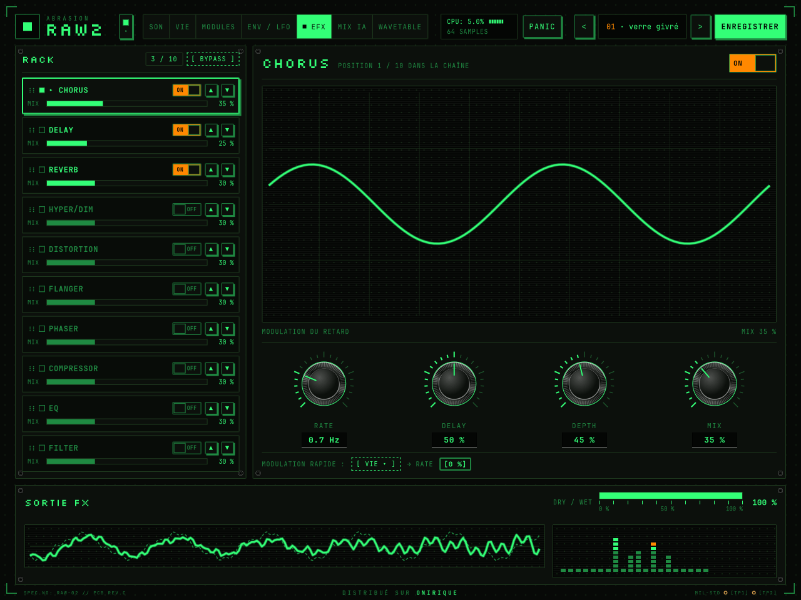 |
| **VIE** | **MODULES** |
| 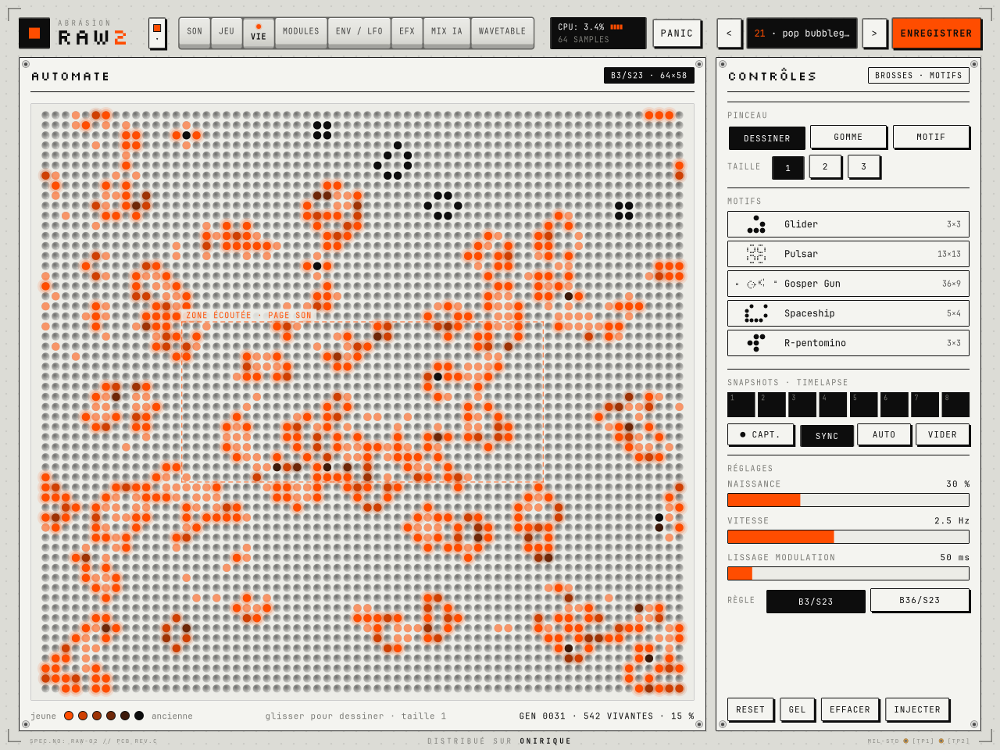 | 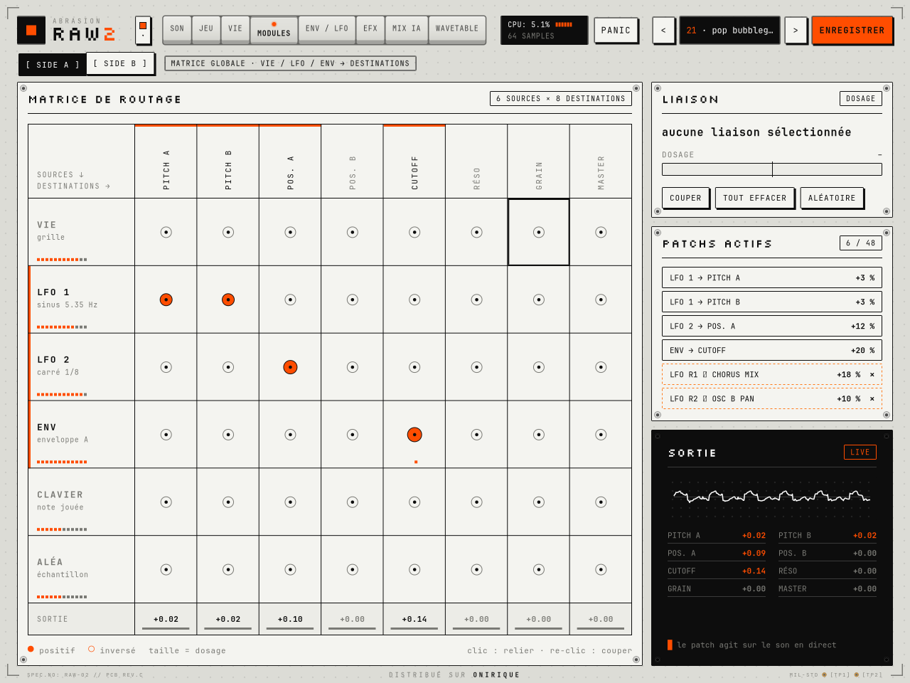 |
| **MIX IA** | **WAVETABLE** |
| 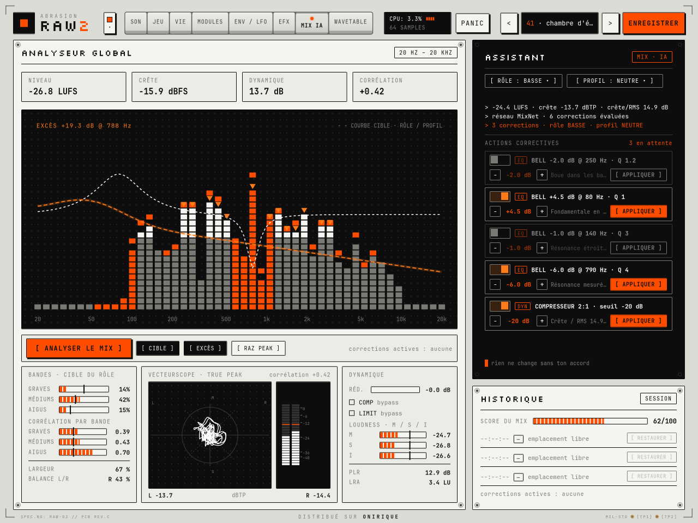 | 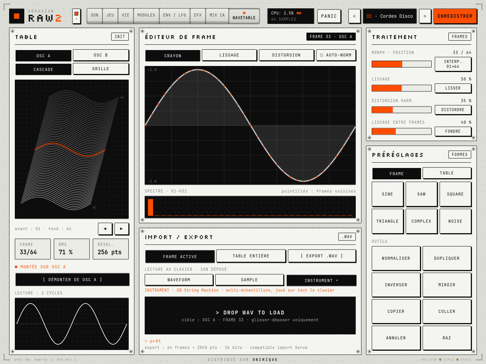 |
| **MODULES, SIDE B (rack, preset « escalier »)** | **Banque de presets** |
| 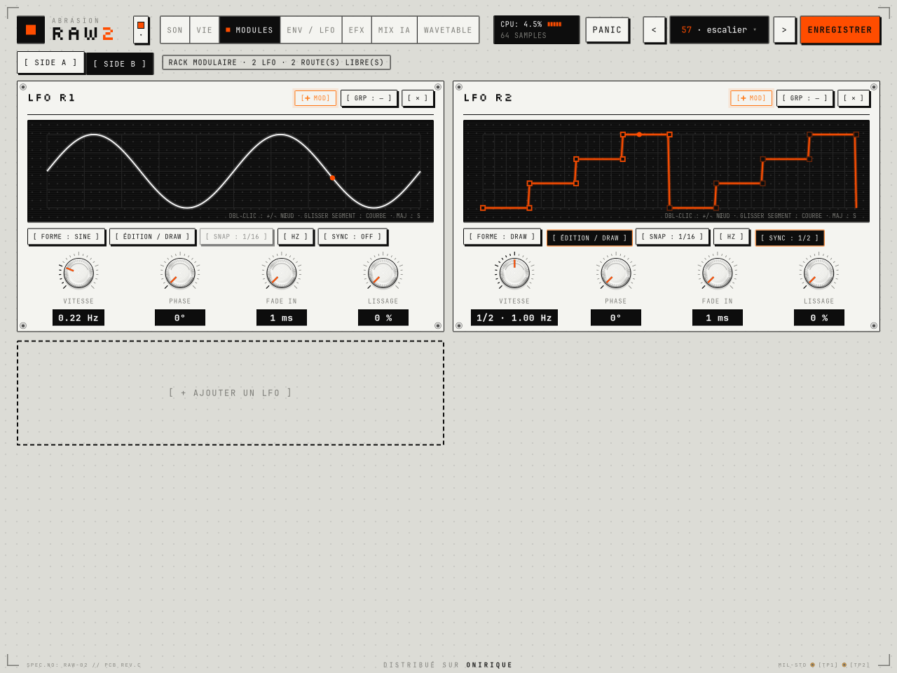 | 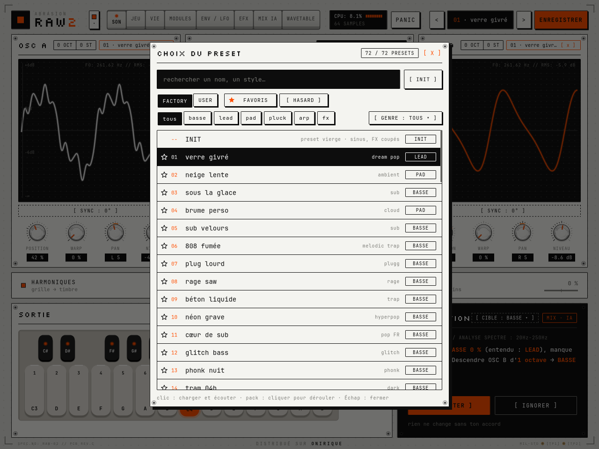 |

### Moteur audio

- **16 voix** (v6), 2 oscillateurs wavetable par voix (64 frames × 256 points, lecture interpolée entre
  frames). Pour l'audio, chaque table est convertie en **mipmaps anti-repliement** (18 niveaux,
  jusqu'à 511 harmoniques dans le grave, 2048 points, Hermite sur les niveaux riches et fondu
  continu d'un niveau à l'autre) sur un thread à part, puis échangée sans verrou. Vol de voix en
  fondu de 3 ms, légère dérive analogique par voix, drive anti-crénelé (ADAA).
- Deux enveloppes ADSR par voix, une par oscillateur, à courbe réglable (attaque `u^(1/q)`, déclin
  et relâche `(1-u)^q`, `q = 4^((c-0,5)×2)`, formules de la maquette ; attaque 1 ms à 5 s, déclin
  5 ms à 5 s, relâche 5 ms à 10 s), filtre passe-bas 12 dB/oct (SVF, un par côté pour garder le
  panoramique de chaque oscillateur), octave / demi-tons, niveaux en dB (`-(1 - v) × 18,2`), master.
- **Jeu (v6)** : une couche d'entrée (accords, strum, arpégiateur calé sur la position de lecture de
  l'hôte, ou sur son horloge interne à l'arrêt) alimente la couche des voix : POLY, MONO (pile de
  notes, dernière note prioritaire) ou LEGATO (l'enveloppe ne repart pas), glide exponentiel en
  demi-tons (`1,5 s × v²`), unison 1 à 8 copies désaccordées et réparties en stéréo. Le mode 808
  ajoute à l'attaque une chute de hauteur (jusqu'à +36 demi-tons, 5 ms à 400 ms) et un
  sous-oscillateur sinus. Les basses d'usine « 808 fumée », « béton liquide », « phonk nuit » et
  « plug lourd » jouent en LEGATO avec glide : deux notes qui se chevauchent glissent.
- **Filtre (v7)** : 12 dB/oct, ou 24 dB/oct en deux étages (Butterworth à la résonance nulle), avec
  un drive à saturation douce avant le filtre. La vélocité règle le niveau et l'ouverture du filtre.
- **Instruments (v8)** : lecteur multi-échantillons cubique stéréo, avec zones de touches et de
  vélocité, boucles, accord fin et gains SFZ, chargé en tâche de fond puis publié sans verrou
  (même mécanisme que les sons déposés).
- Deux LFO globaux : ils repartent de leur PHASE (et refont leur FADE IN) quand on joue une note
  après un silence, et suivent le tempo de l'hôte en SYNC. Les 21 réglages de la page ENV / LFO
  sont des paramètres du DAW, ajoutés à la suite des autres (projets existants compatibles).
- WARP : `u += w × 0,22 × sin(2πu)` sur la phase lue ; LOOP relit la première moitié de la forme deux
  fois ; FREE part d'une phase au hasard et dérive de 0,15 Hz.
- Molettes : pitch bend et modulation (CC1) liés aux contrôleurs MIDI de l'hôte (`IMidiMapping`),
  donc les molettes du clavier maître pilotent celles de l'écran.
- **Rack d'effets** (`src/dsp/Effects.cpp`), dans l'ordre choisi, après le mélange des voix et avant
  le master : HYPER/DIM (copies retardées et désaccordées, réparties en stéréo), DISTORTION (4 formes : TAPE,
  TUBE, FOLD, HARD CLIP, **anti-crénelées par primitive (ADAA)** et suréchantillonnées 1× / 2× / 4× par
  filtres demi-bande), FLANGER, PHASER (6 passe-tout), CHORUS (3 voix par côté), DELAY (20 ms à 1 s,
  amorti, passe-haut dans la boucle, léger ping-pong), REVERB (pré-délai, diffuseurs, réseau de 8
  lignes à lecture Hermite et modulation aléatoire), COMPRESSOR (stéréo lié, détection passe-haut,
  genou doux, relâche selon le programme, réduction affichée), EQ 3 cloches SVF à fréquences
  réglables, FILTER (SVF passe-bas résonant avec saturation d'entrée), **VINTAGE** (v7 : pleurage et
  scintillement de bande, saturation, passe-bas, souffle et craquements qui suivent le signal,
  réduction de fréquence et de résolution) et **PUMP** (v7 : sidechain calé sur le tempo de
  l'hôte, 1/2 à 1/16, profondeur et courbe). Mesures et détails :
  `docs/DSP-FEUILLE-DE-ROUTE.md`, § 5.1.
  Tous les réglages sont lissés (20 ms), marche / arrêt et changement d'ordre en fondu : aucun clic.
  Les effets d'espace et de modulation se dosent comme un envoi (le sec reste plein jusqu'à MIX
  50 %), les autres en fondu sec / traité. Les 70 réglages d'effets sont des paramètres du DAW
  (automatisables), ajoutés à la suite des anciens : les projets existants restent compatibles.
- **La Vie** : **un seul monde** torique de 64 × 58 (page VIE), B3/S23 ou B36/S23, sur son propre
  thread ; l'audio ne lit que des atomiques. La page SON en montre la **zone écoutée** (36 × 16 au
  centre, encadrée sur la page VIE) : c'est elle qui module le son, quelle que soit la page ouverte.
  **NAISSANCE** règle la densité du RESET **et** les naissances spontanées : quand le monde
  s'éteint (densité sous NAISSANCE / 4) ou se fige (même image depuis 12 générations), des germes
  naissent au hasard, d'autant plus que NAISSANCE est haute (à 0 %, Conway pur, qui peut mourir).
  Mesuré : à 30 %, la zone écoutée n'est jamais vide sur 2 minutes. Snapshots, SYNC, AUTO
  (toutes les 16 générations).
- **Matrice 6 × 8** (VIE, LFO 1, LFO 2, ENV (enveloppe A), CLAVIER, ALÉA →
  PITCH A/B, POS. A/B, CUTOFF, RÉSO, GRAIN, MASTER), dosage −100 … +100 %.
- **Chaîne de mastering (MIX IA)** : jusqu'à 12 filtres SVF (cloches, plateaux) en double,
  compresseur 2:1 (détection passe-haut 100 Hz, genou 6 dB, relâche double) et **limiteur True
  Peak** à anticipation de 1,5 ms : sa latence (72 échantillons à 48 kHz) est **déclarée à l'hôte**,
  qui la compense. Mesures de sortie BS.1770-4 (M, S, I, LRA), True Peak 4x, corrélations.
- Aucune allocation ni verrou dans `process()`.

### Presets et fichiers

- 72 presets d'usine (`resources/data/presets.json`, compilés dans `src/core/FactoryData.cpp`
  par `tools/gen_data.py`), **refaits avec leurs effets** : chaque preset a **sa propre recette**
  écrite à la main (`src/core/FactoryFx.cpp`) selon son nom et son style : jeu d'effets, ordre du
  rack, réglages, dosage, forme et suréchantillonnage de la distorsion, modulation rapide. Deux
  presets n'ont jamais le même jeu d'effets, y compris dans une même catégorie (72 combinaisons
  différentes, vérifié par les tests). Exemples parmi les basses : « sub velours » passe dans un
  filtre feutré et un compresseur doux, « rage saw » dans une saturation HARD CLIP 4× suivie d'un
  filtre ouvert par l'enveloppe, « tram 04h » dans un filtre lent, un phaser et une réverbe sombre,
  « acid peluche » dans un filtre résonant à enveloppe et un délai. WARP / PAN / mode de phase
  restent propres à chacun.
  Chaque preset a aussi **sa voix** (`tools/gen_voices.py` → `src/core/FactoryVoice.inc`) : ses deux
  enveloppes (une basse a un « clic » court sur l'OSC B et un corps tenu sur l'OSC A, un pad monte
  lentement et l'OSC B arrive après l'OSC A, un pluck n'a pas de maintien…), ses deux LFO (vibrato
  qui arrive en fondu sur les leads, wobble calé sur le tempo pour « néon grave », S&H en 1/16 pour
  les sons glitch, houle lente sur les pads…), son filtre et ses liaisons de modulation.
  Et **son rack modulaire** (même fichier) : des LFO R1 à R6 et des routes libres vers n'importe
  quel potard, plus des formes dessinées. Les pads font respirer leur réverbération et leur image
  stéréo, les leads flottent dans le panoramique et dosent leur délai, les basses agressives font
  pomper leur saturation, les plucks tombent sur une chute dessinée, les arps ont un gate ou des
  marches calés sur le tempo, les sons FX des rebonds et du hasard sur leurs effets. Aucune route
  ne vise un effet coupé (vérifié).
  Le volume de chaque preset avec ses effets a été **mesuré et recalé** (`tools/fx_trim.cpp`, notes
  de 0,75 s, quatre départs de l'automate) : même niveau perçu que sans effets (+1,5 dB de
  présence), crêtes sous −3 dBFS en régime établi.
- **Packs** : le plugin lit le dossier **`Documents\Raw 2`** (il le crée au besoin). Un
  sous-dossier de fichiers `.raw` = un pack (avec un `pack.json` facultatif pour le nom, l'auteur et
  la version), un fichier `.raw2pack` = un pack (format de la maquette : preset d'usine de départ
  + retouches). On installe un pack en le copiant dans ce dossier ou en le **glissant sur la
  fenêtre des presets** ; [ RETIRER ] l'envoie à la corbeille. Tout est décrit dans
  [`docs/PACKS.md`](docs/PACKS.md), pour qui veut fabriquer et distribuer des packs. Pas besoin
  d'installateur : le dossier se crée tout seul.
- Presets utilisateur : bouton **ENREGISTRER** (nom proposé : USER 01, USER 02…) ou
  « + SAUVER LE SON ACTUEL » → `Documents\Raw 2\Mes presets\<nom>.raw`, pack MES PRESETS.
  Format JSON versionné (`"format": "RAW2-preset", "version": 3`) : paramètres (effets, enveloppes
  et LFO compris), ordre du rack, tables (forme d'origine si la table n'a pas été modifiée, sinon
  les 64 × 256 points en base64), matrice. Un preset de version 1 se charge avec les effets coupés,
  un preset de version 2 avec l'enveloppe B copiée sur l'enveloppe A. Les presets enregistrés par
  les versions précédentes (`Documents\RAW2 banque presets`) sont recopiés dans MES PRESETS au
  premier lancement.
- Export WAV de la page WAVETABLE (64 frames × 2048 points, 16 bits, compatible Serum) :
  `Documents\Raw 2\Wavetables\`.
- L'état complet de l'instance (paramètres, effets et leur ordre, tables, matrice, grilles de la vie,
  snapshots, corrections MIX IA, octave / gamme / HOLD du clavier, thème, page) est sauvé dans le
  projet du DAW.

## L'IA : deux petits réseaux de neurones, dans le plugin

Tout tourne en local, dans la DLL, sans internet ni bibliothèque : un perceptron multicouche
écrit à la main (`src/ai/Mlp.cpp`), des poids compilés dans `src/ai/AiWeights.cpp`. Rien ne
s'exécute dans le thread audio : l'analyse se fait dans le thread de l'interface ou dans un thread
de travail à priorité basse.

**MixNet (page MIX IA).** Pendant les 4,5 s d'écoute, la vraie sortie du plugin est résumée en
40 valeurs (24 bandes de 30 Hz à 16 kHz, niveau, crête, dynamique, stéréo, brillance, mouvement,
attaques…). Le réseau (40 → 64 → 64 → 10) donne pour chacune des 6 corrections une confiance
et, pour les EQ, un **dosage en dB**. Dans la page de la maquette mise à jour, sa confiance
annote les actions correctives qu'il connaît (« réseau 87 % ») et désactive celles qu'il juge
inutiles (sous 20 %) ; le dosage, lui, vient de l'écart mesuré au gabarit du rôle. Le score du mix
devient l'estimation du réseau : il monte quand on applique ce qu'il demandait.

**RoleNet + assistant (carte PROPOSITION, page SON).** L'assistant rejoue ton son en interne,
hors ligne, avec le même moteur (une note grave, une note médium, un petit arpège : 3,6 s rendues
en ~35 ms) sans toucher à ce qui joue. Le réseau (120 → 64 → 32 → 5) dit à quel rôle le son
ressemble (BASSE, LEAD, PAD, ARP / SEQ, TEXTURE). Ensuite l'assistant **essaie 30 à 50
retouches** (niveaux, HARMONIQUES / ESPACE / TEXTURE, hauteur de l'OSC B, filtre, enveloppe,
vitesse et règle de la vie, et maintenant les **effets** : MIX de chaque effet actif, couper un
effet, ajouter DISTORTION, CHORUS, REVERB ou COMPRESSOR), réécoute chaque essai et garde les 3 qui rapprochent le plus le son
du rôle visé. Les pourcentages affichés (« BASSE 12 % → 41 % ») sont donc **mesurés** sur le son
modifié. Avec la cible AUTO, le rôle visé est celui que le réseau reconnaît. L'analyse se relance
seule 0,6 s après un changement du son (≈ 1 s de calcul sur un cœur).

**Entraînement.** Il n'existe pas de base de données « son de synthé + bonne correction » : les
données sont fabriquées avec le moteur du plugin (`tools/train_ai.cpp`, outil `raw2_train`).
- RoleNet : les 72 presets d'usine **avec leurs effets**, 48 variantes chacun (réglages, WARP,
  dosage des effets, parfois un effet de plus ou de moins, DRY / WET), étiquetés par leur catégorie.
- MixNet : 20 000 boucles de 3 s jouées par ces presets, auxquelles on ajoute au hasard des défauts
  connus (bosse de 3 à 8 dB à 250 Hz ou 3,5 kHz, aigus ou graves creusés, volume en dents de
  scie, crêtes à 0 dBFS). Le réseau apprend à retrouver le défaut et à doser l'inverse.
- La validation se fait sur 15 presets mis de côté, jamais entendus pendant l'apprentissage.
  Résultats : voir [`docs/IA.md`](docs/IA.md) (chiffres complets, matrice de confusion,
  comparaison avec les anciennes règles).

**Résultats, sur des presets jamais entendus** (détail dans `docs/IA.md`) : RoleNet reconnaît le
bon rôle **70 %** du temps (au hasard : 20 %). Les BASSES sont toujours reconnues ; la confusion vient
des rôles qui se ressemblent vraiment depuis que chaque preset a sa voix : des leads à note courte
(« tiktok bell ») pris pour des ARP, des pads très mouvants pris pour des TEXTURES. Pour que le
réseau juge le son et pas l'habillage, un tiers des exemples reçoit le rack d'effets d'un autre
preset, et un tiers les enveloppes et LFO d'un autre preset de la même catégorie. MixNet prend **82 %** de bonnes décisions, contre 65 % pour les
anciennes règles, et dose les EQ à 1,2 dB près en moyenne.

**Limites, honnêtement.** Ce sont de petits réseaux (≈ 20 000 poids en tout) entraînés sur les sons
de RAW 2 : ils ne connaissent pas ton morceau, seulement ce que le plugin produit. MixNet est sûr de
lui sur les crêtes (99 %), le volume irrégulier et la dureté vers 3,5 kHz. Pour les EQ, quand il
propose quelque chose il a raison 6 à 9 fois sur 10 (un peu moins pour les aigus à 8 kHz), mais il
laisse passer beaucoup de défauts légers : il préfère se taire plutôt qu'inventer un problème.
« BASSE », « PAD »… veulent dire « ressemble aux presets de cette catégorie ». Pour ré-entraîner (par exemple après avoir changé
les presets) :

```powershell
build\bin\raw2_train.exe --out src\ai\AiWeights.cpp --report docs\IA.md
cmake --build build --config Release
```

(~7 min sur 4 cœurs ; `--quick` pour un essai en 30 s, `--cache dossier` pour ne pas tout
re-rendre.)

## Points ouverts du brief (§9) : ce que j'ai proposé

Ces choix sont **à écouter et à valider** ; ils sont regroupés pour être faciles à changer.

1. **Lien vie → son** (`Engine::controlUpdate`). Ce qui joue est la zone écoutée du monde (la
   grille de la page SON, encadrée sur la page VIE), quelle que soit la page affichée. La maquette
   avait deux mondes séparés, qui ne montraient pas la même chose : ils sont réunis.
   - **QUANTITÉ** dose l'action de la grille sur la **CIBLE** : densité + impulsion à chaque
     génération (naissances), vers le cutoff (FILTRE, ±3 octaves), la position de table
     (POSITION) ou le volume (NIVEAU).
   - **HARMONIQUES** : densité → brillance (cutoff ±2 octaves) et saturation douce.
   - **ESPACE** : centre de masse de la grille → panoramique des voix, plus un élargissement
     stéréo modulé par la densité ; négatif = image inversée.
   - **TEXTURE** : nuage de grains relus dans les 2 dernières secondes du son, déclenchés par
     les naissances ; la destination GRAIN de la matrice s'y ajoute.
2. **Filtre** : SVF passe-bas 12 dB/oct, paramètres `cutoff` et `reso`.
3. **Enveloppes** : la maquette mise à jour a sa page ENV / LFO (une enveloppe par oscillateur,
   voir plus haut). La source ENV de la matrice est l'enveloppe A. Chaque preset d'usine a ses
   enveloppes, ses LFO et ses liaisons de matrice (`tools/gen_voices.py`).
4. **Modules** : voir le point 1.
5. **IA de mixage** : deux petits réseaux de neurones locaux (voir « L'IA » plus haut). Si les poids
   n'étaient pas entraînés, MIX IA retomberait sur les règles d'origine (`finishAnalysis`).
6. **Format `.raw`** : JSON versionné, décrit plus haut.
7. **Échelle** : zoom par paliers + facteur DPI fourni par l'hôte.
8. **Volume des presets** : mesuré par les tests (une note, 1 s) : crêtes entre −5 et −19 dBFS,
   basses plutôt fortes comme voulu. Avec les effets, chaque preset est recalé par `raw2_fx_trim`
   (correction écrite dans `src/core/FxTrim.inc`, appliquée au MASTER du preset). Reste à écouter
   dans FL Studio.
9. **Effets** (maquette v2) : la maquette donne les noms, les réglages et les courbes ; le DSP est
   à moi (formules en tête de `src/dsp/Effects.cpp`). La maquette donnait le même rack à tous les
   presets d'une catégorie ; à ta demande, chaque preset a maintenant sa recette (format décrit en
   tête de `src/core/FactoryFx.cpp`, facile à retoucher : modifier une ligne, recompiler, puis
   recaler le volume et recompiler encore :
   `build\Release\raw2_fx_trim.exe src\core\FxTrim.inc`). La modulation rapide agit sur le premier
   réglage de l'effet, avec la profondeur affichée (±50 %).
10. **Anti-clic** :
    - rendu identique quelle que soit la taille des blocs de l'hôte (FL Studio en envoie de
      variables) ;
    - oscillateurs couplés en alternatif (aucune composante continue, donc pas de « toc » quand les
      notes s'arrêtent) et coupe-continu final à 5 Hz ;
    - automations appliquées à l'échantillon près, avec 12 ms de lissage ;
    - PANIC et activation en fondu de 5 ms ;
    - un preset sonne toujours pareil, quel que soit celui chargé avant (rien ne déborde de la Vie
      ni de la source ALÉA).

    Audit DSP complet, architecture cible et feuille de route :
    [`docs/DSP-FEUILLE-DE-ROUTE.md`](docs/DSP-FEUILLE-DE-ROUTE.md).

Petites libertés prises par rapport à la maquette, toutes signalées dans le code :
NIVEAU à 0 coupe l'oscillateur (affiché `-∞ dB`) ; `SAMPLES` règle le bloc de calcul des
modulations (32 → 256) puisque la taille de buffer appartient à l'hôte ; le nom d'une table
chargée est raccourci au lieu de faire passer le titre « OSC A » à la ligne ;
les lignes COMP / LIMIT de DYNAMIQUE s'activent au clic ; dans MIX IA, la courbe cible suit le
niveau moyen (en énergie) du spectre pour que l'excès mesure une forme et non un volume.

## Ce qui a été vérifié, et les limites

- **Vérifié ici** (Linux) :
  - compilation Linux (GCC 13) et Windows en compilation croisée (MinGW-w64, GCC 13) **sans
    aucun avertissement** ;
  - tests de l'IA (`raw2_ai_test`) : caractéristiques audio, inférence, rôles des presets,
    défauts ajoutés bien repérés, dosage réellement appliqué, assistant (≈ 1 s), résultats
    identiques avec la version Windows sous Wine ;
  - tests des effets (`raw2_fx_test`) : chaque effet seul et la chaîne complète restent finis et
    stables à 44,1 / 48 / 96 kHz, aucun clic à la marche / arrêt, au changement d'ordre, de forme
    de distorsion ou de TIME du délai, DRY / WET à 0 rend l'entrée exacte, repliement de la
    distorsion (ADAA + suréchantillonnage) −32,5 dB (1×) → −54 dB (2×) → −76 dB (4×), EQ ±12 dB
    exacts, réduction du compresseur égale à l'affichage, rack complet plus de 20 fois plus rapide
    que le temps réel ;
  - tests du mastering (`raw2_master_test`) : sinus 997 Hz à −20 dBFS lu −20,00 LUFS, porte de
    l'intégrée, True Peak entre échantillons, limiteur sous son plafond True Peak, latence exacte,
    EQ exacte et sans saut, passe-haut de détection du compresseur, corrélation et largeur ;
  - tests du moteur : les 72 presets jouent sans NaN ni écrêtage, matrice / modules / chaîne de
    mix à fond restent stables, aller-retour WAV, sauvegarde / rechargement d'état, la vie
    avance ; AddressSanitizer et UBSan propres ;
  - mini-hôte VST3 : chargement, liaison processeur ↔ contrôleur (directe et par messages),
    notes MIDI, automation, état, **ouverture et fermeture de l'éditeur** ;
  - les binaires Windows lancés sous Wine : tests du moteur et des effets, mini-hôte avec
    l'éditeur Direct2D et `RAW2Preview.exe` (capture de la page EFX dessinée par Direct2D :
    `docs/img/windows-direct2d-wine.png`) ;
  - rendu de chaque page et de chaque thème comparé à la maquette (captures dans `docs/img`).
- **Pas testé** : la compilation avec MSVC / Visual Studio 2026 (pas disponible ici, le code
  a été relu pour MSVC ; les versions précédentes compilaient chez toi), une vraie machine
  Windows, FL Studio, et le son à l'oreille (surtout le dosage des effets des presets).
- Le moteur de la vie utilise l'horloge audio quand l'hôte fait tourner le son, sinon
  l'horloge murale.

## Arborescence

```
src/core/      paramètres, presets, état, la Vie, JSON, WAV, fichiers
src/dsp/       tables d'onde (formes, mipmaps, outils), moteur audio, rack d'effets, FFT
src/ai/        IA : caractéristiques audio, réseaux (inférence + poids), écoute interne, assistant
src/ui/        dessin abstrait (Direct2D / Cairo), widgets, éditeur et ses 7 pages, analyse
src/platform/  fenêtre Win32 (souris, clavier, glisser-déposer, DPI)
src/vst3/      processeur, contrôleur, vue, usine VST3
src/preview/   RAW2Preview (Windows)
tests/         tests du moteur, des effets, de l'IA, mini-hôte VST3
tools/         gen_data.py (presets / thèmes), gen_voices.py (enveloppes, LFO et modulations des
               presets), train_ai.cpp (entraînement de l'IA), fx_trim.cpp (volume des presets avec
               effets), snap.cpp (captures)
resources/     polices (OFL) et données JSON du dossier de passation
third_party/   en-têtes d'interface VST3 (MIT)
```

Sous Linux, CMake compile aussi le moteur, les tests et un outil de capture (`raw2_snap`,
rendu Cairo) : cela sert seulement au développement, la cible est Windows.
