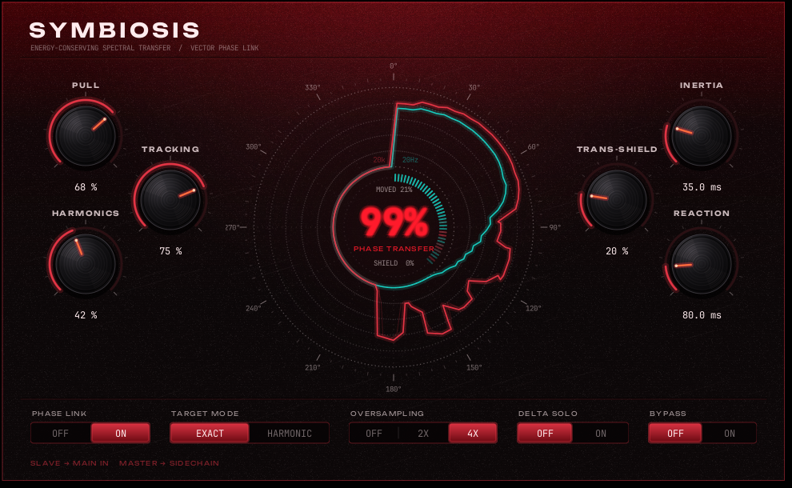

# SYMBIOSIS

Processeur VST3 de **transfert spectral à énergie conservée** et d'**alignement
vectoriel de phase**. Quand deux pistes se masquent (kick contre 808, voix contre
instrumentale), Symbiosis ne baisse pas le gain de la piste secondaire. Il retire
l'énergie de la zone masquée et la remet sur les partiels et harmoniques que cette
piste possède déjà. Sur la bande de conflit, il recale aussi la phase de la piste
secondaire sur celle de la piste maître, pour que la somme soit constructive
(cos Δφ → 1).



*Capture prise sous Linux (Xvfb) : une 808 à 55 Hz sur l'entrée principale, un kick
sur le sidechain, Phase Link actif. Tracé cyan = maître, tracé braise = esclave
redistribué, anneau intérieur = cohérence de phase par bande.*

## Routage

| Bus VST3 | Rôle |
|---|---|
| Entrée 0 (Main), stéréo ou mono | piste esclave x₂(t) : 808, pad, sample… |
| Entrée 1 (Aux, sidechain), stéréo ou mono | piste maître x₁(t) : kick, voix lead… |
| Sortie 0 (Main) | esclave restructuré x̃₂(t) |

Insérer Symbiosis sur la piste esclave, puis router la piste maître vers son entrée
sidechain. Sans sidechain, le plugin laisse passer le signal intact, retardé de la
latence annoncée.

**Latence : 2048 échantillons**, déclarés à l'hôte (`getLatencySamples`). Le DAW
compense automatiquement. Le bypass sort le signal sec retardé d'autant, sans clic.

## Compiler

Prérequis : **CMake ≥ 3.25** (exigé par le SDK VST3 3.8) et un compilateur C++20 :
Visual Studio 2022/2026 sous Windows, les outils Xcode sous macOS.

Le SDK Steinberg officiel (MIT depuis la 3.8, avec VSTGUI4 sous BSD) est téléchargé
automatiquement à la configuration (tag `v3.8.1_build_84`). Pour utiliser un SDK
local, passer `-DVST3_SDK_ROOT=/chemin/vers/vst3sdk` ou le placer dans
`symbiosis/vst3sdk`.

Windows, depuis « Developer PowerShell for VS », à la racine du dépôt :

```powershell
cmake -S symbiosis -B build-symbiosis -A x64
cmake --build build-symbiosis --config Release
```

macOS (binaire universel Apple Silicon + Intel) :

```bash
cmake -S symbiosis -B build-symbiosis -DCMAKE_BUILD_TYPE=Release "-DCMAKE_OSX_ARCHITECTURES=arm64;x86_64"
cmake --build build-symbiosis --parallel
```

Le plugin est produit dans `build-symbiosis/VST3/Release/Symbiosis.vst3`. Copier ce
dossier en entier dans `C:\Program Files\Common Files\VST3\` (Windows) ou
`~/Library/Audio/Plug-Ins/VST3/` (macOS). Après chaque compilation, le **validateur
Steinberg** tourne tout seul sur le plugin.

Linux (test uniquement) : le SDK demande les paquets de développement xcb, xkbcommon,
cairo, pango, fontconfig, freetype et gtkmm-3.0 (voir `.github/workflows/build.yml`).

Options CMake :

| Option | Défaut | Effet |
|---|---|---|
| `SYMBIOSIS_BUILD_PLUGIN` | ON | plugin VST3 (demande le SDK) |
| `SYMBIOSIS_BUILD_TESTS` | ON | tests DSP, sans le SDK (`ctest --test-dir build-symbiosis -C Release`) |
| `SYMBIOSIS_BUILD_SDK_HOSTS` | OFF | compile aussi `editorhost` du SDK, pour ouvrir l'interface sans DAW |
| `VST3_SDK_ROOT` | `symbiosis/vst3sdk` | SDK local ; téléchargé s'il est absent |

## Paramètres

| ID | Nom | Plage | Défaut | Rôle |
|---|---|---|---|---|
| `kParamPullId` | Pull | 0 – 1 | 0.68 | γ : énergie extraite de la zone masquée, E = min(A₂², γ·A₁²) |
| `kParamHarmonicsId` | Harmonics | 0 – 1 | 0.42 | η : part de l'énergie extraite réinjectée sur les partiels |
| `kParamInertiaId` | Inertia | 1 – 150 ms | 35 ms | attaque du transfert |
| `kParamReactionId` | Reaction | 5 – 500 ms | 80 ms | relâchement du transfert |
| `kParamTrackingId` | Tracking | 0 – 1 | 0.75 | adhérence aux partiels réels (seuil de détection et largeur des bassins) |
| `kParamTransShieldId` | Trans-Shield | 0 – 1 | 0.20 | protection des transitoires |
| `kParamPhaseLinkId` | Phase Link | Off / On | On | alignement vectoriel constructif |
| `kParamDeltaSoloId` | Delta Solo | Off / On | Off | écoute de la différence x̃₂ − x₂ |
| `kParamTargetModeId` | Target Mode | Exact / Harmonic | Exact | gabarit de redistribution |
| `kParamOversamplingId` | Oversampling | Off / 2x / 4x | 4x | suréchantillonnage spectral (voir plus bas) |
| `kParamBypassId` | Bypass | Off / On | Off | bypass hôte (`kIsBypass`), compensé en latence |

Double-clic, ou Ctrl-clic (Cmd-clic sur Mac), sur un potentiomètre : retour à la valeur par défaut.

## Le traitement, trame par trame

STFT : N = 2048, H = 512 (recouvrement 75 %), fenêtre de Hann périodique (COLA).
L'analyse est liée en stéréo : les décisions sont prises sur la puissance
L + R, puis appliquées aux deux canaux, ce qui garde l'image stable.

1. **Énergie masquée** : ρ[k] = min(1, γ·|X₁|²/|X₂|²), lissé par Inertia
   (montée) et Reaction (descente). Le résidu vaut |X₂|²·(1 − ρ).
2. **Redistribution**, avec un budget de η·Σ ρ|X₂|² :
   - *Exact Peaks* : crêtes locales de |X₂|² au-dessus du seuil Tracking, en
     excluant les crêtes elles-mêmes masquées (ρ ≥ 0,5). Poids W = |X₂[m]|²/Σ|X₂[mⱼ]|².
   - *Harmonic Series* : f₀ par YIN, affiné sur la crête spectrale. Cibles 2f₀,
     3f₀, 4f₀ avec des poids (1/h)/Σ(1/i). Une cible est retenue si le maître ne la
     masquerait pas de nouveau une fois l'énergie déposée. Sans f₀ détectée, le mode
     se replie sur Exact Peaks pour la trame.
   - Un partiel est relevé d'un seul bloc : tous les bins de son bassin (de vallée
     à vallée, limité à ±Δ bins par Tracking) reçoivent le même gain
     g = √(1 + ΔE/R). L'énergie arrive donc sur le partiel sans déformer son lobe.
     Une harmonique absente du spectre (808 quasi sinusoïdale) est synthétisée :
     un lobe de Hann calculé exactement, verrouillé en phase sur la fondamentale
     (ψₕ = h·ψ₀).
   - Avec η = 1, Σ|Y|² = Σ|X₂|² : les tests mesurent un écart relatif de 10⁻⁸.
3. **Phase Link** : φ₂ ← φ₂ + β·wrap(φ₁ − φ₂). β vaut 1 sur la bande de conflit
   (maître et esclave à moins de 20 dB l'un de l'autre), décroît jusqu'à 0 à 40 dB
   d'écart, et suit Inertia / Reaction. Les bins d'un bassin tournent ensemble, de
   l'angle mesuré sur la crête (*spectral phase locking*).
4. **Trans-Shield** : une attaque dans le saut le plus récent de la trame est
   connue 2048 échantillons avant d'être entendue. ρ et β sont réduits sur les 4
   trames qui la contiennent, ce qui évite le pré-écho de la STFT.
5. iFFT, fenêtre de synthèse w/1,5 (Σw² = 1,5 sur 4 sauts), overlap-add.

Avec Pull = 0 et Phase Link coupé, la sortie est exactement l'entrée retardée de
2048 échantillons (reconstruction parfaite, vérifiée par les tests).

### Écarts assumés par rapport au cahier des charges

- **Oversampling** : c'est un suréchantillonnage *spectral*, pas temporel. La trame
  d'analyse est complétée de zéros jusqu'à 2N ou 4N avant la FFT. La chaîne STFT
  est linéaire et ne contient aucun étage non linéaire, donc un suréchantillonnage
  temporel polyphase n'éviterait aucun repliement. Il ajouterait de la latence et
  élargirait les bins en Hz. Le zero-padding rend plus précis le repérage des
  crêtes, les bassins, l'estimation de f₀ et le placement des harmoniques
  synthétisées.
- **Plafond de gain par partiel : +24 dB.** Un partiel très faible ne peut pas
  absorber une énergie démesurée. La conservation reste exacte tant que le plafond
  n'est pas atteint.
- **Bypass** ajouté (paramètre hôte standard, compensé en latence).
- Les paramètres sont appliqués à chaque saut (10,7 ms à 48 kHz), pas à
  l'échantillon près. Les transitions sont fondues par l'overlap-add.
- Traitement en 32 bits flottants uniquement (le validateur le signale).
- CMake : le SDK 3.8 exige CMake 3.25 (le cahier demandait 3.22), et la fonction
  `smtg_initialize_plugin_package` n'existe pas dans le SDK. Le paquet est décrit par
  `smtg_add_vst3plugin`, `smtg_target_add_plugin_resources` (polices) et
  `smtg_target_set_bundle` (macOS).

## Temps réel

- `process()` n'alloue rien et ne prend aucun verrou. Tous les tampons (trames, FFT
  2048 / 4096 / 8192, tables trigonométriques, YIN) sont alloués dans
  `setupProcessing()`, et `setActive(true)` les remet à zéro.
- FTZ/DAZ (`_MM_SET_FLUSH_ZERO_MODE`, `_MM_SET_DENORMALS_ZERO_MODE`) sur x86, bit
  FZ du FPCR sur ARM64, pendant toute la durée de `process()`.
- Visualiseur : le thread audio publie au plus 60 images par seconde via l'API
  *Data Exchange* du SDK (`DataExchangeHandler`, sans verrou côté audio, avec un
  repli `IMessage` pour les hôtes qui ne la gèrent pas). Le contrôleur pousse les
  images dans une file SPSC sans verrou (`dsp/ring_buffer.h`), que l'interface lit
  à 60 FPS.
- `setState()` peut arriver depuis le thread de l'interface pendant le traitement.
  Les valeurs sont donc atomiques et prises en compte par le `process()` suivant.
- Charge mesurée (un cœur, stéréo, 48 kHz) : 1,8 % (Off), 3,7 % (2x), 7,7 % (4x)
  en Exact. Le mode Harmonic coûte environ 2,5 points de plus (YIN).

## Interface

VSTGUI4, construite en code (pas de `.uidesc`), 980 × 600.

- Châssis noir #0D0809, grain abrasé au laser généré une fois, lueur bordeaux
  #4A0307 en haut, trait d'usinage 1 px rgba(226, 52, 68, 0.45).
- Polices embarquées dans le paquet (`Resources/Fonts`, licence SIL OFL) :
  **Unbounded** pour les titres (espacement 0,16 em, dessiné glyphe par glyphe) et
  **JetBrains Mono** pour les valeurs (#FFECEE, chiffres tabulaires).
- **Orbit HUD** : réticule pointillé de 0° à 360°. Les spectres sont enroulés sur
  l'orbite, de 20 Hz en haut à 20 kHz dans le sens horaire, le rayon donnant le
  niveau. Maître en cyan #17D4C6, esclave redistribué en braise #E23444 (les erreurs
  de phase le font vriller), entrée esclave en fantôme. L'anneau intérieur montre
  la cohérence de phase par bande (cyan = constructif, braise = destructif).
- Afficheur central **PHASE TRANSFER** en rouge sang incandescent : moyenne de
  (1 + cos(φ₁ − φ̃₂))/2 sur la bande de conflit, pondérée par l'énergie. Autour :
  part d'énergie déplacée, f₀ (mode Harmonic) ou action du Trans-Shield.
- Potentiomètres en aluminium anodisé noir brossé, arc de valeur et marqueur
  incandescents.

## Vérifications

- Tests DSP (`tests/dsp_test.cpp`, également sous ASan et UBSan) : FFT contre DFT
  directe, file SPSC entre deux threads, YIN à ±1 %, reconstruction parfaite en
  1x/2x/4x, latence exacte de 2048 échantillons, conservation de l'énergie
  (10⁻⁸) et RMS préservée à ±0,05 dB, Phase Link (des phases opposées qui
  s'annulaient donnent |x₁ + x̃₂| = A₁ + A₂), série harmonique en 1/h (rapport
  2f₀/4f₀ = √2), Trans-Shield sans pré-écho, absence de NaN, Delta Solo, bypass.
- Validateur Steinberg : 47 tests réussis, 0 échec (stéréo et mono, bypass,
  tailles de bloc variables, traitement sur un autre thread, état).
- Interface ouverte dans `editorhost` du SDK sous Linux, avec de l'audio réel
  traversant le processeur (capture ci-dessus).
- **Pas encore essayé dans un DAW sous Windows ou macOS.** La CI GitHub compile et
  valide le plugin sur Windows, macOS et Linux à chaque push.

## Arborescence

```
symbiosis/
├── CMakeLists.txt
├── source/
│   ├── version.h
│   ├── symbiosis_cids.h           FUID, ID et plages des paramètres
│   ├── symbiosis_processor.*      AudioEffect : bus, état, STFT, flux du HUD
│   ├── symbiosis_controller.*     EditController + IDataExchangeReceiver
│   ├── symbiosis_entry.cpp        fabrique VST3
│   ├── dsp/
│   │   ├── fft_engine.h           FFT réelle radix-2, sans dépendance
│   │   ├── ring_buffer.h          FIFO SPSC sans verrou + historique circulaire
│   │   ├── spectral_engine.h      transfert, phase, harmoniques, Trans-Shield
│   │   └── yin_pitch.h            YIN temps réel
│   └── ui/
│       └── symbiosis_editor.*     VSTGUI4 : châssis, Orbit HUD, potentiomètres
├── resource/                      polices (OFL), ressource de version Windows
├── tests/dsp_test.cpp
└── docs/img/
```
